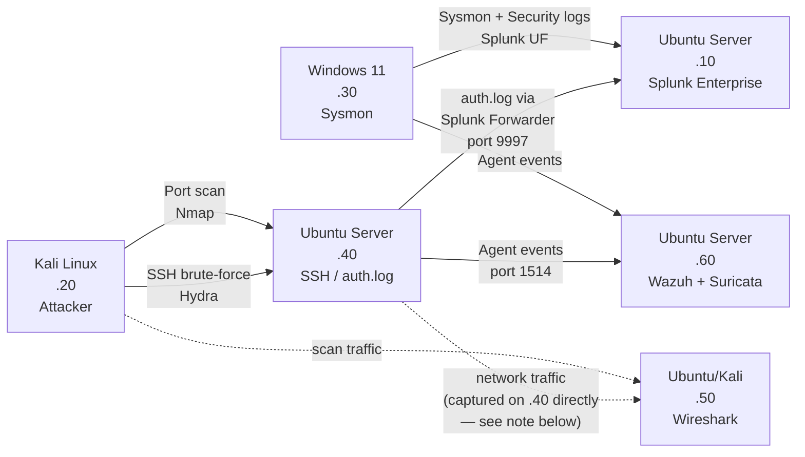

# Architecture

## Network

| Setting | Value |
|---|---|
| Platform | VMware Workstation |
| Network type | Host-only (VMnet2) |
| Network ID | 192.168.152.0 |
| Subnet mask | 255.255.255.0 (/24) |
| Broadcast address | 192.168.152.255 |
| Usable IP range | 192.168.152.1 – 192.168.152.254 |
| Gateway | 192.168.152.1 (VMware host virtual adapter — first address in the range; not used for VM-to-VM routing since all VMs sit on the same Layer 2 segment) |
| DNS | Not configured (static IPs only; outbound DNS not required for an isolated lab) |

## VM inventory

| VM | OS | IP | Role | Purpose |
|---|---|---|---|---|
| SIEM | Ubuntu Server | 192.168.152.10 | Splunk Enterprise | Centralized log collection and correlation |
| Attacker | Kali Linux | 192.168.152.20 | Nmap, Hydra | Simulates external threat actor |
| Endpoint | Windows 11 | 192.168.152.30 | Sysmon, Windows Event Logs | Simulates a monitored workstation |
| Linux Server | Ubuntu Server | 192.168.152.40 | SSH, Authentication Logs | Simulates an exposed Linux service (attack target) |
| Network Monitoring | Ubuntu/Kali | 192.168.152.50 | Wireshark | Packet capture and traffic analysis |
| Security Monitoring | Ubuntu Server | 192.168.152.60 | Wazuh, Suricata | Host-based and network-based intrusion detection |

## Data flow

## Design notes

**Why host-only (VMnet2) instead of NAT or bridged:**
Host-only keeps the lab fully isolated from the home network and the internet. Attack traffic
(Hydra brute-force, Nmap scans) never leaves the virtual switch, so there's no risk of
accidentally scanning or attacking a real device on the home LAN. It also means the lab's IP
scheme is fixed and predictable, which is required for consistent Splunk/Wazuh configuration
and documentation.

**Why static IPs instead of DHCP:**
Static addressing keeps the environment reproducible — SPL queries, Wazuh agent configs, and
documentation all reference fixed IPs instead of resolving names, which also mirrors how
servers are typically addressed in a real enterprise network.

**Subnet choice (192.168.152.0/24):**
A /24 gives 254 usable addresses, far more than the 6 VMs in use, leaving room to add VMs
(e.g., a second endpoint or a web server) without re-addressing the network. 192.168.152.x was
chosen specifically to avoid colliding with common home-router defaults (192.168.0.x,
192.168.1.x), preventing any accidental overlap if bridged networking is used elsewhere on the
same host.

**VM placement / network segmentation logic:**
- **.10 (SIEM)** and **.60 (Security Monitoring)** are kept separate so log collection (Splunk)
  and detection (Wazuh/Suricata) are independent services — if one fails, the other still
  captures data, similar to defense-in-depth in a real SOC.
- **.20 (Attacker)** is isolated conceptually as the only "untrusted" host, even though
  host-only networking doesn't enforce real trust boundaries — this reflects how the lab is
  used, not a technical control.
- **.40 (Linux Server)** is the only intentionally exposed/attacked host, so all detection
  logic (Splunk searches, Wazuh rules, Suricata signatures) is built around traffic to and
  from this one IP, keeping the detections focused and explainable.

**Known limitation — traffic visibility on .50/.60:**
VMware's host-only virtual switch (VMnet2) behaves like a real switch: it only delivers
traffic to the VM it's addressed to, it does not mirror every packet to every VM. This means
Wireshark on **.50** and Suricata on **.60** do **not** automatically see traffic exchanged
between .20 and .40, even though all VMs share the same subnet. VMware Workstation's host-only
vmnets don't support SPAN/port-mirroring the way a physical managed switch does.

**Resolution used in this lab:** packet captures for the SSH brute-force and Nmap scan were
taken directly on the target (.40) using `tcpdump`/Wireshark on that host's own interface,
rather than relying on .50 to see third-party traffic. This is a legitimate and common
real-world pattern (host-based network monitoring co-located with the asset), and is documented
here rather than left unexplained.

## Files in this folder
- `README.md` — this file (network summary, diagrams, design notes)
- `ip-addressing-scheme.md` — full addressing reference (same format as the original design doc)
